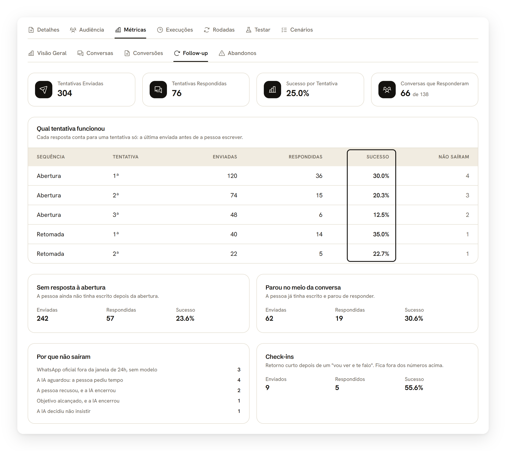

import { Lista, Artigo } from "/components/lista-artigos.jsx";

El panel de una campaña muestra lo que pasó con cada contacto que abordó, desde el primer contacto hasta la conversión, sin que necesites abrir conversación por conversación.

<Note>
  Campañas es una función de los planes Scale y Enterprise. Quién ve: Administrador (Empresa), Gestor de la Empresa, Gestor de Área y Gestor de Unidad. Agente no tiene acceso al panel de la campaña.

  La interfaz de Tartini está en portugués. Los nombres de pantallas y botones aparecen aquí tal como se ven en pantalla, con la traducción entre paréntesis.
</Note>

Dónde está: haz clic en una campaña en **Campanhas > Campanhas** (Campañas > Campañas), o abre **Abrir campanha** (Abrir campaña) en la ficha de un contacto en el Inbox.

---

## Lee la visión general

De forma predeterminada, la pestaña **Métricas** abre en la subpestaña **Visão Geral** (Visión General).

<Steps>
  <Step title="Abre el panel">Haz clic en la campaña en la lista, después en la pestaña **Métricas**.</Step>
  <Step title="Lee los números principales">**Conversas Iniciadas** (Conversaciones Iniciadas), **Taxa de Resposta** (Tasa de Respuesta), **Taxa de Escalação** (Tasa de Escalamiento), **Mensagens Totais** (Mensajes Totales) y **Taxa de Abandono** (Tasa de Abandono) resumen el desempeño hasta ahora.</Step>
  <Step title="Revisa la distribución por estado">La barra muestra cuántas conversaciones están **Ativo** (Activo), **Concluído** (Concluido), **Aguardando Resposta** (Esperando Respuesta), **Transferido** o **Falhou** (Falló).</Step>
</Steps>

{/* CAPTURA: images/campanhas/resultados-visao-geral.png | alt: Sub-aba Visão Geral com os cartões de conversas iniciadas, taxa de resposta e distribuição por status | olhar: os cartões de taxa de resposta e taxa de escalação */}

---

## Mira cada conversación

De forma predeterminada, la subpestaña **Conversas** (Conversaciones) lista todas las conversaciones de la campaña, más recientes primero.

Dónde está: pestaña **Métricas**, subpestaña **Conversas**.

<Steps>
  <Step title="Abre la subpestaña">Haz clic en **Conversas**, dentro de **Métricas**.</Step>
  <Step title="Filtra por agente">Usa el filtro para ver solo las conversaciones sin agente (solo IA) o las de una persona específica.</Step>
  <Step title="Lee la tabla">Cada fila muestra el contacto, cuántas interacciones hubo (de la IA y del contacto), el estado y si la conversación fue transferida.</Step>
</Steps>

<Note>
  La tabla muestra 20 conversaciones por página. Sin ninguna conversación todavía, el panel avisa: las conversaciones aparecen en cuanto los contactos interactúen con la campaña.
</Note>

---

## Sigue las conversiones

De forma predeterminada, la subpestaña **Conversões** (Conversiones) muestra solo los contactos que ya convirtieron.

Dónde está: pestaña **Métricas**, subpestaña **Conversões**.

<Steps>
  <Step title="Mira el resumen">El total de conversiones, la tasa sobre las conversaciones iniciadas y el valor sumado, si la campaña tiene valor por conversión configurado.</Step>
  <Step title="Cambia el filtro">Marca **Todos os contatos** (Todos los contactos) para ver quién todavía no convirtió.</Step>
  <Step title="Marca una conversión manualmente">En la lista de ejecuciones, usa **Marcar conversão** (Marcar conversión) para registrar una conversión que la definición de éxito no capturó sola.</Step>
</Steps>

{/* CAPTURA: images/campanhas/resultados-conversoes.png | alt: Sub-aba Conversões com os cartões de total, taxa de conversão e valor somado | olhar: o botão Marcar conversão na lista de execuções */}

<Note>
  Una conversión marcada manualmente aparece con el origen **Manual**. Las demás muestran el origen real: **Processo concluído** (Proceso concluido), **Transferência qualificada** (Transferencia calificada), **Dados coletados** (Datos recolectados) o **Sinal externo** (Señal externa).
</Note>

---

## Mira qué follow-up funcionó

De forma predeterminada, la subpestaña **Follow-up** muestra los intentos que envió la campaña y cuáles tuvieron respuesta.

Dónde está: pestaña **Métricas**, subpestaña **Follow-up**.

<Steps>
  <Step title="Lee los números principales">**Tentativas Enviadas** (Intentos enviados), **Tentativas Respondidas** (Intentos respondidos), **Sucesso por Tentativa** (Éxito por intento) y **Conversas que Responderam** (Conversaciones que respondieron) resumen el resultado.</Step>
  <Step title="Compara los intentos">La tabla **Qual tentativa funcionou** (Qué intento funcionó) muestra cada posición de **Abertura** (Apertura) y **Retomada** (Reanudación), con cuántos salieron y cuántos tuvieron respuesta.</Step>
  <Step title="Separa por lo que hizo la persona">Las tarjetas **Sem resposta à abertura** (Sin respuesta a la apertura) y **Parou no meio da conversa** (Se detuvo a mitad de la conversación) muestran el resultado de cada situación.</Step>
  <Step title="Mira lo que no salió">**Por que não saíram** (Por qué no salieron) lista los motivos, como la ventana de 24 h cerrada o un pedido de tiempo de la persona.</Step>
</Steps>

<Frame caption="La columna Sucesso muestra qué intento funcionó">
  
</Frame>

<Note>
  Cada respuesta cuenta para un solo intento: el último enviado antes de que la persona escribiera. Quien entró por palabra clave y se detuvo enseguida cuenta en **Sem resposta à abertura**.
</Note>

---

## Mira los abandonos

De forma predeterminada, la subpestaña **Abandonos** muestra conversaciones que fueron transferidas al equipo y después quedaron sin respuesta.

Dónde está: pestaña **Métricas**, subpestaña **Abandonos**.

La tasa de abandono aparece en verde por debajo de 30%, en amarillo entre 30% y 49%, y en rojo a partir de 50%. La tabla muestra cuándo se transfirió cada conversación, cuándo se envió la alerta y la última interacción registrada.

---

## Dónde aparecen las conversaciones en el Inbox

Toda conversación abierta por una campaña aparece en el Inbox con un chip **Campanha** (Campaña), lo que ayuda a diferenciarla de una conversación iniciada por el cliente por cuenta propia. En la ficha del contacto, el nombre de la campaña aparece para cualquier agente; solo quien es gestor tiene el link **Abrir campanha** (Abrir campaña) para llegar directo al panel.

---

## Preguntas frecuentes

<AccordionGroup>
  <Accordion title="¿Dónde veo las conversaciones de una campaña?">
  En la pestaña **Métricas › Conversas** del panel de la campaña, o en el Inbox, buscando el chip **Campanha** en las conversaciones.
  </Accordion>
  <Accordion title="¿Por qué aparecen intentos sin detalle en Follow-up?">
  Son intentos enviados antes de que existiera el registro por intento. Aparecen en el aviso de la parte superior de la subpestaña y quedan fuera de las tasas.
  </Accordion>
  <Accordion title="¿El regreso después de un &quot;voy a ver y te aviso&quot; cuenta como intento?">
  No. Aparece en **Check-ins**, fuera de los números de follow-up, porque la campaña no lo configura.
  </Accordion>
  <Accordion title="¿Cómo marco una venta manualmente?">
  En la pestaña **Métricas › Conversões**, usa **Marcar conversão** en la fila del contacto. El origen queda registrado como **Manual**.
  </Accordion>
  <Accordion title="¿La tasa de abandono cuenta toda conversación detenida?">
  No. Cuenta solo conversaciones que fueron transferidas al equipo y después quedaron sin interacción, no conversaciones que Tino todavía está conduciendo.
  </Accordion>
  <Accordion title="¿Una campaña sin definición de éxito muestra conversiones?">
  Solo las marcadas manualmente. Sin una definición de éxito configurada, el panel avisa que la campaña es anterior a ese modelo, pero todavía acepta marcación manual.
  </Accordion>
</AccordionGroup>

---

## Artículos relacionados

<Lista>
  <Artigo titulo="Crea una campaña" href="/es/campanhas/crie-uma-campanha">Dónde se elige la definición de éxito.</Artigo>
  <Artigo titulo="Programa el envío y los follow-ups" href="/es/campanhas/agendamento-e-follow-ups">Pausar, reanudar y seguir la cola.</Artigo>
  <Artigo titulo="La ficha del contacto" href="/es/inbox/ficha-do-contato">Dónde aparece el link Abrir campanha.</Artigo>
  <Artigo titulo="Usa la Central de Conversaciones" href="/es/inbox/central-de-conversas">Otra forma de seguir conversaciones en curso.</Artigo>
</Lista>
